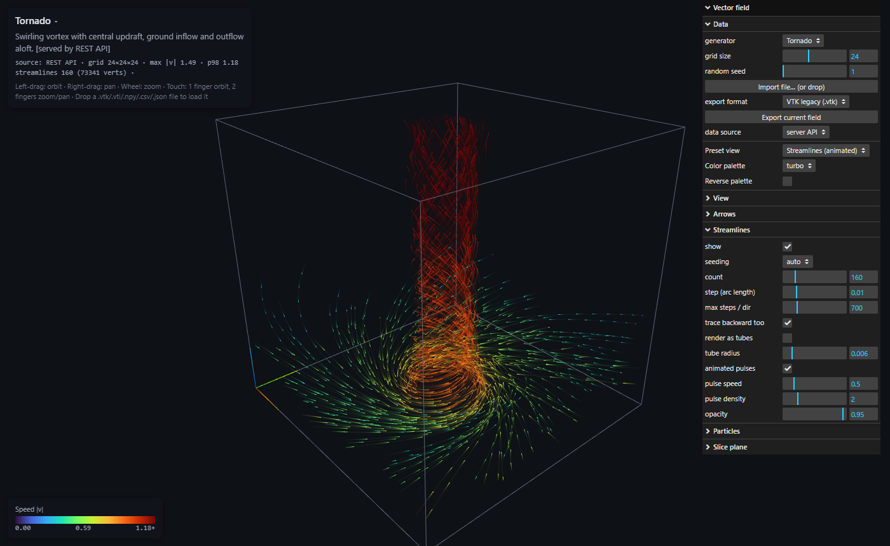
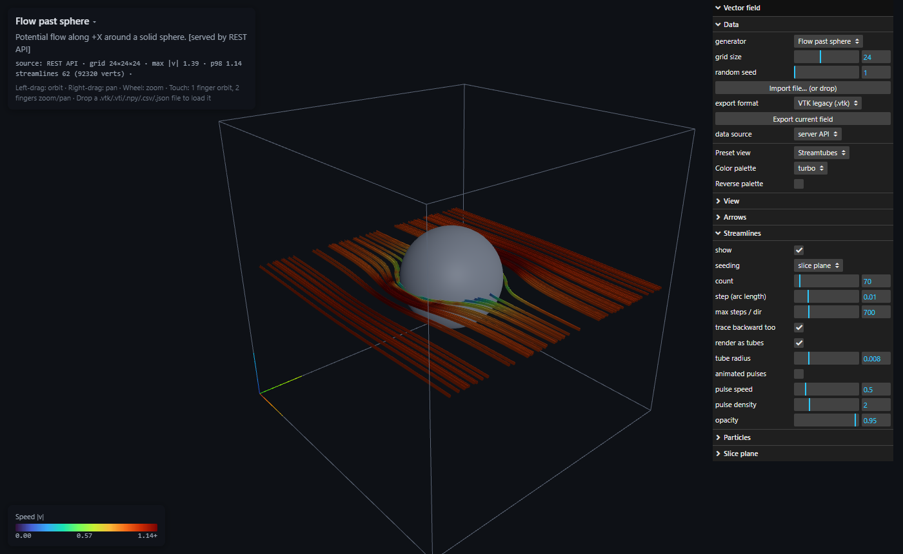

# field-viz

A WebGL viewer for 3D vector fields on regular grids (air flow, velocity fields, force fields).
It is a single HTML page using three.js, with an optional stdlib-only Python REST backend.





## Features

- **Synthetic generators:** tornado, flow past a sphere (potential flow), ABC flow, turbulent wind
  (curl noise), Lorenz attractor, sources and sinks, convection rolls.
- **Display modes:**
  - **Arrow glyphs:** across the whole volume or only on the slice layer.
  - **Streamlines:** RK4 integration, forward and backward from each seed. Drawn as lines with
    animated pulses that move at the flow speed, or as shaded tubes.
  - **Particles:** advected particles with fading trails.
  - **Slice plane:** colored by speed, vorticity |∇×v|, divergence ∇·v, or vx/vy/vz.
- **Seeding** (for streamlines and particles): per-field default, random, inlet face, slice plane,
  sphere, diagonal rake, ground ring.
- **Presets:** arrows overview, animated streamlines, stream tubes, particle smoke, slice + vectors,
  vorticity + streamlines, everything.
- **Palettes:** turbo, viridis, plasma, inferno, magma, cividis, jet, ice, greys, coolwarm, RdBu, PiYG.
  Any palette can be reversed, and the slice plane can use its own palette.
- **Views:** perspective or orthographic projection, auto-rotate, bounding box.
- **Mobile:** works on phones and tablets (touch orbit/zoom, collapsible panels, lighter defaults).
- **Import/export:** VTK legacy, VTK XML ImageData, NumPy, CSV, JSON (see below). You can also
  drag and drop a file onto the page.

## Running

**With the backend.** Requires Python 3.8+ and nothing else:

```
python server.py            # or: python server.py 8080
```

Open <http://localhost:8000/>. The page detects the API and adds a *data source* switch
(server API or browser JS).

**Without the backend.** Serve the folder with any static server, or open `index.html` directly.
All fields are then generated in the browser.

```
python -m http.server       # or: npx serve, nginx, GitHub Pages, ...
```

**Static page with the API on another host:** `index.html?api=http://localhost:8000/`
(the backend sends CORS headers).

three.js and lil-gui are loaded from the jsDelivr CDN, so the page needs internet access.

## REST API

| Request | Response |
|---|---|
| `GET /api/fields` | list of generators `[{id, name, desc, seeding}]` |
| `GET /api/fields/<id>?n=24&seed=1` | `{id, name, desc, seeding, dims:[nx,ny,nz], data:[vx,vy,vz,...]}` |
| `GET /api/fields/<id>?n=24&format=vtk` | file download; `format` = `json` \| `vtk` \| `vti` \| `npy` \| `csv` |

`n` must be between 2 and 64. Generator ids: `tornado`, `sphere`, `abc`, `turbulence`, `lorenz`, `charges`, `convection`.

## Data formats

Vectors are stored point by point on a regular grid, with x varying fastest, then y, then z.
For display the grid is always stretched to fill [-1, 1]³, so the physical origin and spacing
stored in a file are ignored.

| Format | Import | Export | Notes |
|---|---|---|---|
| `.vtk` VTK legacy | ✓ | ✓ | `STRUCTURED_POINTS`, ASCII or BINARY; uses the first point `VECTORS` (or a 3-component `FIELD` array). Opens in ParaView/VisIt. |
| `.vti` VTK XML ImageData | ✓ | ✓ | `ascii` or inline `binary` (uncompressed). Appended or compressed data is not supported. |
| `.npy` NumPy | ✓ | ✓ | `float32`, shape `(nz, ny, nx, 3)`, so `a[k, j, i]` is the vector at (x_i, y_j, z_k). Shape `(3, nz, ny, nx)`, other dtypes and Fortran order are also accepted. |
| `.csv` | ✓ | ✓ | Columns `x,y,z,vx,vy,vz`. Also accepts `u,v,w` or ParaView names (`Points:0`, `velocity:0`, ...). Rows may be in any order but must form a complete grid. |
| `.json` | ✓ | ✓ | `{"dims":[nx,ny,nz], "data":[vx,vy,vz,...]}` |

Loading data from NumPy:

```python
import numpy as np
a = np.load("field.npy")          # (nz, ny, nx, 3)
vx, vy, vz = a[..., 0], a[..., 1], a[..., 2]
```

Writing a field for the viewer:

```python
np.save("my_field.npy", field.astype(np.float32))   # field shape (nz, ny, nx, 3)
```

## Adding a generator

- **Backend:** add a factory to `GENERATORS` in `server.py`. It returns `f(x, y, z) -> (vx, vy, vz)`
  over the domain [-1, 1]³.
- **Browser:** add the matching entry to `GENERATORS` in `index.html`. Use the same display name
  so the per-field decorations and seeding are reused.

## License

MIT, see [LICENSE](LICENSE).
