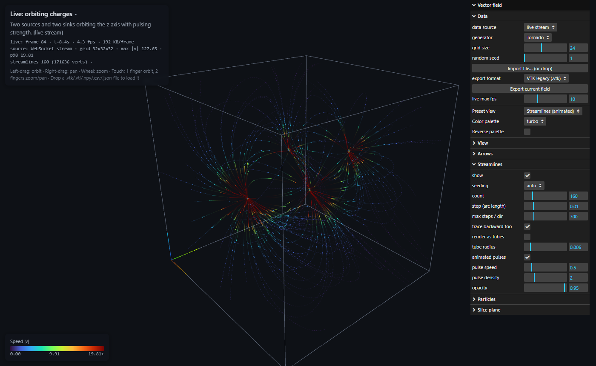

# field-viz

A WebGL viewer for 3D vector fields on regular grids (air flow, velocity fields, force fields).
It is a single HTML page using three.js. Two backends are optional: a stdlib-only Python REST
server, and a Flask + ZeroMQ relay that streams time-varying data live.


## Features

- **Synthetic generators:** tornado, flow past a sphere (potential flow), ABC flow, turbulent wind
  (curl noise), Lorenz attractor, sources and sinks, convection rolls.
- **Display modes:**
  - **Arrow glyphs:** across the whole volume or only on the slice layer.
  - **Streamlines:** RK4 integration, forward and backward from each seed. Drawn as lines with
    animated pulses that move at the flow speed, or as shaded tubes.
  - **Particles:** advected particles with fading trails.
  - **Slice plane:** colored by speed, vorticity |∇×v|, divergence ∇·v, or vx/vy/vz.
- **Seeding** (for streamlines and particles): per-field default, random, inlet face, slice plane,
  sphere, diagonal rake, ground ring.
- **Presets:** arrows overview, animated streamlines, stream tubes, particle smoke, slice + vectors,
  vorticity + streamlines, everything.
- **Palettes:** turbo, viridis, plasma, inferno, magma, cividis, jet, ice, greys, coolwarm, RdBu, PiYG.
  Any palette can be reversed, and the slice plane can use its own palette.
- **Views:** perspective or orthographic projection, auto-rotate, bounding box.
- **Mobile:** works on phones and tablets (touch orbit/zoom, collapsible panels, lighter defaults).
- **Live streaming:** time-varying fields from any Python process, through ZeroMQ, a Flask
  WebSocket relay and binary frames to the browser.
- **Import/export:** VTK legacy, VTK XML ImageData, NumPy, CSV, JSON (see below). You can also
  drag and drop a file onto the page.

## Running the examples

| | What runs | Data source in the viewer | Needs |
|---|---|---|---|
| 1 | page only | in-browser generators | a browser |
| 2 | `server.py` | REST API (+ in-browser) | Python 3.8+, no packages |
| 3 | `stream_server.py` + `producer.py` | live WebSocket stream (+ REST, in-browser) | `pip install -r requirements.txt` |
| 4 | `stream_server.py` + your own code | live stream of your data | same as 3 |

The page detects which backend it is talking to and adds a **data source** switch.
three.js and lil-gui load from the jsDelivr CDN, so the page needs internet access.

### 1. Static, no backend

Open `index.html` directly, or serve the folder with any static server
(`python -m http.server`, nginx, GitHub Pages, ...). All fields are generated in the browser.

### 2. REST server

```
python server.py              # http://localhost:8000/   (python server.py 8080 for another port)
```

To keep a static page but fetch data from a server on another host, add `?api=`:
`index.html?api=http://localhost:8000/`. The backend sends CORS headers.

### 3. Live streaming demo



```
pip install -r requirements.txt     # flask, flask-sock, pyzmq, numpy

# terminal 1: a time-varying field published over ZeroMQ
python producer.py                                   # wandering tornado, 32^3, 10 fps
python producer.py --scenario turbulence --n 40 --fps 5 --dtype int16
python producer.py --scenario cycle                  # tornado -> turbulence -> charges every 20 s

# terminal 2: relay to browsers (also serves the page and the REST API)
python stream_server.py                              # http://localhost:8000/
python stream_server.py --host 0.0.0.0               # allow phones etc. on your network
```

Start the two in either order. When a producer is running, the page selects **live stream**
automatically; you can also add `?live` to the URL. The info panel shows the frame number,
simulation time, fps and frame size. The **live max fps** slider limits how often the page asks
for new frames. Particles keep moving through the field while it updates, and the colour range
is smoothed over time so colours don't flicker.

How it works:

```
producer(s) ──ZeroMQ PUB/SUB──▶ stream_server.py ──WebSocket, binary──▶ browsers
            [meta JSON, frame]  keeps only the newest frame    "next" → newest frame
```

- **Binary frames:** a 40-byte header followed by raw float32 values, or int16 values with a
  scale factor (`--dtype int16` halves the size). The browser uses the data almost as-is, with
  no parsing.
- **Pull-based, newest frame wins:** each client sends `next` when it is ready, and the relay
  answers with the newest frame. A slow client skips frames instead of falling behind, so
  nothing queues up and latency stays at one frame.
- `GET /api/stream` reports the relay status: `{endpoint, frames, fps, bytes, age}`.

The frame layout is documented in [fieldstream.py](fieldstream.py), which also provides
`encode_frame` / `decode_frame`.

### 4. Streaming your own data

```python
from fieldstream import FieldPublisher

pub = FieldPublisher("tcp://*:5556", dtype="float32")    # or dtype="int16"
while simulation_running:
    v = step()                                  # numpy array, shape (nz, ny, nx, 3)
    pub.send(v, name="My CFD run", desc="time step %d" % i, seeding="inlet")
```

Then run `python stream_server.py`; it subscribes to `tcp://localhost:5556` by default, or set
`--zmq tcp://host:port`. For several producers, run the relay with `--bind` and create each
publisher with `FieldPublisher("tcp://relay-host:5556", bind=False)`.

Both servers use development web servers, which is fine on a local machine or LAN. For anything
public, put the Flask app behind a production server.

## REST API

| Request | Response |
|---|---|
| `GET /api/fields` | list of generators `[{id, name, desc, seeding}]` |
| `GET /api/fields/<id>?n=24&seed=1` | `{id, name, desc, seeding, dims:[nx,ny,nz], data:[vx,vy,vz,...]}` |
| `GET /api/fields/<id>?n=24&format=vtk` | file download; `format` = `json` \| `vtk` \| `vti` \| `npy` \| `csv` |

`n` must be between 2 and 64. Generator ids: `tornado`, `sphere`, `abc`, `turbulence`, `lorenz`, `charges`, `convection`.

## Data formats

Vectors are stored point by point on a regular grid, with x varying fastest, then y, then z.
For display the grid is always stretched to fill [-1, 1]³, so the physical origin and spacing
stored in a file are ignored.

| Format | Import | Export | Notes |
|---|---|---|---|
| `.vtk` VTK legacy | ✓ | ✓ | `STRUCTURED_POINTS`, ASCII or BINARY; uses the first point `VECTORS` (or a 3-component `FIELD` array). Opens in ParaView/VisIt. |
| `.vti` VTK XML ImageData | ✓ | ✓ | `ascii` or inline `binary` (uncompressed). Appended or compressed data is not supported. |
| `.npy` NumPy | ✓ | ✓ | `float32`, shape `(nz, ny, nx, 3)`, so `a[k, j, i]` is the vector at (x_i, y_j, z_k). Shape `(3, nz, ny, nx)`, other dtypes and Fortran order are also accepted. |
| `.csv` | ✓ | ✓ | Columns `x,y,z,vx,vy,vz`. Also accepts `u,v,w` or ParaView names (`Points:0`, `velocity:0`, ...). Rows may be in any order but must form a complete grid. |
| `.json` | ✓ | ✓ | `{"dims":[nx,ny,nz], "data":[vx,vy,vz,...]}` |

Loading data from NumPy:

```python
import numpy as np
a = np.load("field.npy")          # (nz, ny, nx, 3)
vx, vy, vz = a[..., 0], a[..., 1], a[..., 2]
```

Writing a field for the viewer:

```python
np.save("my_field.npy", field.astype(np.float32))   # field shape (nz, ny, nx, 3)
```

## Adding a generator

- **Backend:** add a factory to `GENERATORS` in `server.py`. It returns `f(x, y, z) -> (vx, vy, vz)`
  over the domain [-1, 1]³.
- **Browser:** add the matching entry to `GENERATORS` in `index.html`. Use the same display name
  so the per-field decorations and seeding are reused.

## License

MIT, see [LICENSE](LICENSE).
